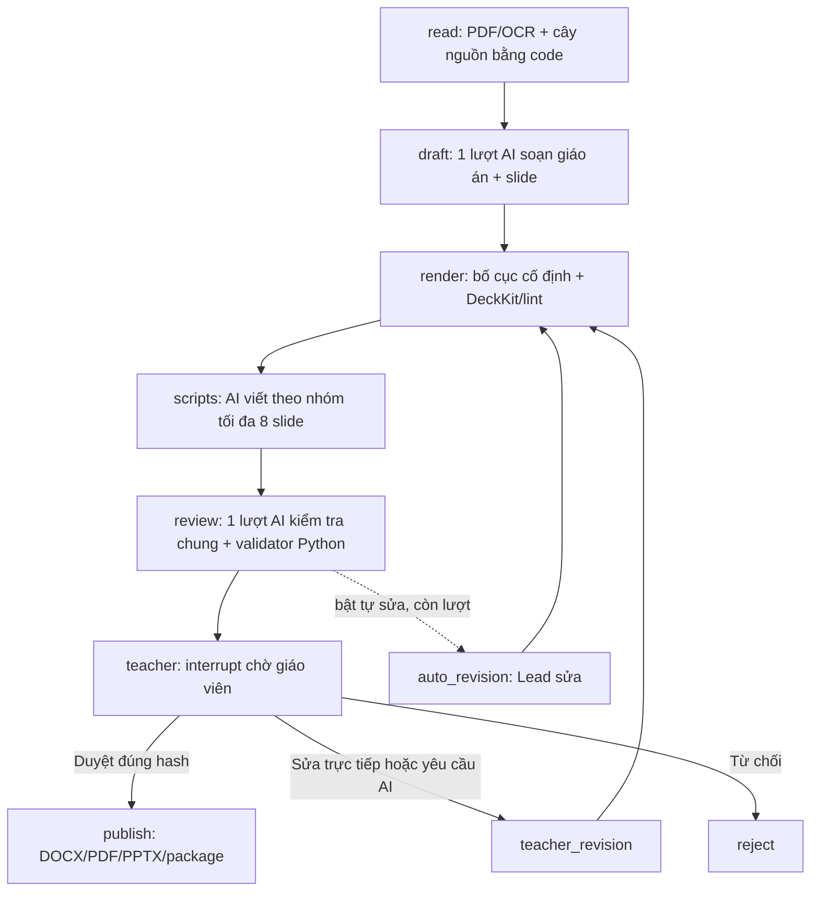

# MAIC — LangGraph tối giản

Triển khai ngày 2026-10-10, thay thế luồng nhiều Peer trong thiết kế ban đầu.
Phạm vi vẫn là PDF → giáo án, slide, lời giảng → giáo viên duyệt → xuất bản.
Đây là cách điều phối một model có sẵn bằng LangGraph, không huấn luyện model mới.

## Luồng đang chạy



`app/workflow.py` dùng `StateGraph`, SQLite/PostgreSQL checkpointer và cùng `thread_id` khi resume.
State chứa snapshot dữ liệu, không tích lũy lịch sử hội thoại. Node định tuyến chỉ chạy Python.
Hai tên node cũ `lesson`/`slides` chỉ là đường tương thích để tiếp tục checkpoint cũ;
job mới luôn đi qua `draft`. Nếu đang dừng tại node cũ, bước soạn được chạy lại theo hợp đồng mới.

## Số lần gọi AI

| Bước | Luồng cũ | Luồng mới |
|---|---:|---:|
| Giáo án + nội dung + bố cục | 3 | 1; bố cục bằng Python |
| Lời giảng cho N slide | N | ceil(N / B), B mặc định 8 |
| Phản biện + critic | 4 | 1 |
| Tổng lượt đầu | N + 7 | 2 + ceil(N / B) |

Với 8 slide: 15 → 3 lần gọi, giảm 80% số lượt theo cấu trúc luồng.
Với 20 slide: 27 → 5 lần gọi. Chưa tính sửa bài, lỗi/retry hoặc cache hit.
**Không đồng nghĩa giảm 80% token hoặc chi phí.** Chưa benchmark chất lượng/usage thật của luồng mới.

Một lượt review trả về bốn nhóm kết quả: sư phạm, nội dung, đánh giá và trình bày.
Chúng chia sẻ cùng lượt suy luận, **không phải bốn phản biện độc lập**.
Schema review hiện có được giữ để giao diện, kiểm tra duyệt và package tiếp tục dùng được.
Mặc định không tự sửa; giáo viên quyết định sửa gì trước khi phát sinh thêm lượt AI.

## Ngân sách mặc định

| Biến môi trường | Giá trị | Ý nghĩa |
|---|---:|---|
| `MAIC_CONTEXT_TOKENS` | 4.000 | Trần văn bản nguồn ở chế độ retrieved |
| `MAIC_MAX_CALL_INPUT_TOKENS` | 32.000 | Trần input **ước tính** mỗi lượt |
| `MAIC_MAX_CALL_OUTPUT_TOKENS` | 12.000 | Trần output gửi cho provider |
| `MAIC_MAX_INPUT_TOKENS` | 100.000 | Ngân sách input mỗi job |
| `MAIC_MAX_OUTPUT_TOKENS` | 40.000 | Ngân sách output mỗi job |
| `MAIC_MAX_MODEL_CALLS` | 12 | Số lượt tối đa, tính cả lượt lỗi |
| `MAIC_MAX_AUTO_ROUNDS` | 0 | Có thể bật 1–2; mặc định chờ giáo viên |
| `MAIC_SCRIPT_BATCH_SIZE` | 8 | Số script tối đa trong một lượt |
| `MAIC_MAX_JOB_SECONDS` | 1.800 | Ngân sách thời gian xử lý |

Output được đặt theo bước và chặn bởi trần mỗi lượt:
draft `2500 + 400 × số slide`; scripts `1000 + 1200 × số slide trong nhóm`;
review `3000`; revision `2500 + 450 × số slide`.
Giới hạn quá nhỏ có thể làm output bị cắt; ứng dụng dừng và giữ checkpoint, không tự tăng giới hạn hoặc gọi lại.
`max_output_tokens` tính cả token reasoning và phần không hiển thị theo
[tài liệu OpenAI về token](https://developers.openai.com/api/docs/guides/token-counting).

Input được ước tính bằng `o200k_base`, gồm system/task/JSON/schema, dự phòng 10% + 256 token và 2.000 token/ảnh.
Tokenizer và ảnh phụ thuộc model, nên đây là kiểm tra trước khi gửi, **không phải trần input chính xác của provider**.
Usage API thay thế dự phòng khi có kết quả, kể cả response lỗi có usage.
Lỗi mạng hoặc lỗi parse không lấy được usage giữ nguyên dự phòng; không được coi là miễn phí.
Input thực tế có thể vượt ước tính ở một lượt; lượt tiếp theo bị chặn nếu hết ngân sách job.

## Cách giảm token

- Chọn nguồn theo độ liên quan bằng Python; giữ nguyên evidence được tham chiếu. Nếu nguồn bắt buộc vượt trần, dừng với lỗi rõ ràng thay vì cắt citation hoặc tự tăng context.
- `context_mode=full` chỉ dùng cho benchmark; vẫn chịu giới hạn input mỗi lượt và mỗi job.
- Không gửi toàn cây kiến thức, hướng dẫn upstream dài hoặc danh sách nguồn không sử dụng vào mỗi prompt.
- JSON gửi model không có khoảng trắng thừa. Không có agent điều phối dùng LLM và không giữ chat history.
- Lời giảng dùng hoạt động liên quan và tiêu đề trước/sau, không lặp toàn giáo án cho từng slide.
- Ảnh render được ghép thành bảng theo nhóm. Nguồn OCR liên quan vẫn được gửi (tối đa 6 trang/lượt).
- Cache theo model/prompt/schema/dữ liệu/ảnh/giới hạn output trong từng job. Retry nhóm script lỗi dùng lại nhóm đã hoàn tất.
- Khi giáo viên sửa, chỉ sinh lại script mất hiệu lực; sửa riêng lời giảng giữ nguyên bản giáo viên đã nhập.

Thu nhỏ bảng ảnh và gộp review có thể làm giảm khả năng phát hiện lỗi nhỏ. Lint và giáo viên vẫn cần kiểm tra.
Các giá trị trên là điểm khởi đầu có thể kiểm soát, chưa phải cấu hình tối ưu đã được đo trên mọi tài liệu.

## Chạy và kiểm tra

Cách cài/chạy giữ như [README](README.md). `.env` và biến môi trường ghi đè mặc định Python;
Compose đã truyền các biến ngân sách này vào web/worker. Khởi động lại tiến trình sau khi đổi cấu hình.
Không ghi API key vào prompt, log hoặc artifact.

```powershell
.\.venv\Scripts\python -m pytest -q --basetemp ./data/pytest-minimal
.\.venv\Scripts\python -m ruff check app tests scripts
npm --prefix frontend run build
```

Test dùng API giả lập để kiểm tra cap, cache, usage lỗi, khóa ngân sách; fixture workflow kiểm tra số lượt,
script mất hiệu lực, resume, hash duyệt và phiên bản bất biến. Chúng không chứng minh chất lượng nội dung AI.
Luồng duyệt dùng [LangGraph interrupt/resume](https://docs.langchain.com/oss/python/langgraph/interrupts).
