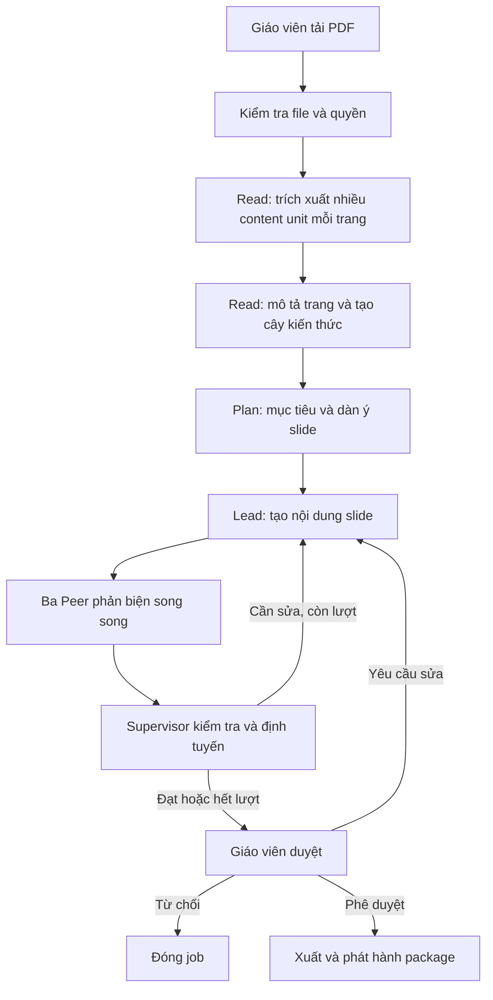

# Thiết kế Offline SLP: từ PDF đến bài giảng slide

> **Cập nhật triển khai 2026-10-10:** Tài liệu dưới đây giữ thiết kế nhiều Peer ban đầu. Luồng đang dùng đã được rút gọn theo [LANGGRAPH_MINIMAL.md](LANGGRAPH_MINIMAL.md): một lượt soạn giáo án + slide, script theo nhóm, một lượt kiểm tra chung, mặc định không tự sửa. Các mô tả ba Peer độc lập và hai vòng sửa mặc định bên dưới không còn là cấu hình hiện hành.

**Phiên bản:** 3.0 · **Ngày:** 09/10/2026  
**Luồng:** PDF → Read → cây kiến thức → Plan → Lead → Peers → Supervisor → Giáo viên duyệt → PPTX/PDF  
**Model ưu tiên:** GPT-6 Luna (`gpt-6-luna`), thay đổi được qua cấu hình

## 1. Mục tiêu và phạm vi

Giáo viên tải PDF lên. Hệ thống trích xuất nội dung theo trang, tạo dàn ý và nội dung từng slide, nhờ các Peer phản biện, rồi dừng để giáo viên duyệt. Sau khi duyệt, hệ thống xuất PPTX/PDF và lưu gói bài giảng có cấu trúc để giai đoạn Online dùng lại.

“Offline” là giai đoạn chuẩn bị học liệu trước giờ học, không có nghĩa hệ thống phải chạy khi mất Internet. Online sẽ có workflow và trạng thái riêng, đọc gói bài giảng đã phát hành.

Thiết kế lấy cảm hứng từ quy trình **Read → Plan** của MAIC. Read trích xuất nội dung, tạo mô tả và cây kiến thức; Plan dùng cấu trúc đó để tạo tài nguyên dạy học. Dự án này chọn PDF làm đầu vào và tạo bộ slide mới làm đầu ra, nên phần tạo slide là mở rộng so với trọng tâm của paper MAIC. MAIC là tham khảo phương pháp, không bắt buộc phải dùng đúng vai agent hoặc công nghệ của họ.

Nguyên tắc MVP:

- Supervisor điều phối bằng luật rõ ràng, không cần LLM để quyết định tuyến đi.
- Lead là agent duy nhất tạo và sửa bài giảng.
- Ba Peer phản biện song song theo ba góc nhìn; không sửa trực tiếp bài.
- Parser PDF và OCR là công cụ, không phải agent. Chỉ OCR trang scan hoặc phần không trích xuất được.
- Giáo viên duyệt bản cuối trước khi phát hành.
- Package có cấu trúc là nguồn chuẩn; PPTX/PDF là bản trình bày được kết xuất.

## 2. Quy trình và nodes



| Node | Trách nhiệm |
|---|---|
| `validate_pdf` | Kiểm tra loại file, dung lượng, số trang, quyền và khả năng đọc. |
| `read_document` | Tách từng trang thành nhiều content unit (tiêu đề, đoạn, công thức, bảng, hình, ví dụ); chạy OCR khi cần và giữ page/source ID. |
| `build_knowledge_tree` | Tạo mô tả trang, cây chương/section/khái niệm và liên kết nhiều-nhiều giữa content unit với các nút kiến thức. |
| `plan_lesson` | Lead đề xuất đối tượng học, mục tiêu đo được, trình tự chủ đề và dàn ý slide dựa trên cây kiến thức. |
| `create_slides` | Lead viết nội dung theo template, kèm ghi chú giảng và nguồn trang. |
| `peer_review` | Ba Peer nhận cùng một snapshot và phản biện độc lập. |
| `supervisor_route` | Kiểm schema, nguồn, finding và số vòng; chọn sửa, dừng hoặc chuyển giáo viên. |
| `teacher_review` | Dừng graph bằng LangGraph `interrupt()` để giáo viên duyệt, yêu cầu sửa hoặc từ chối. |
| `export_publish` | Kết xuất PPTX/PDF và phát hành package theo version sau khi duyệt. |

Trong MVP, plan và tạo slide có thể là hai bước của cùng Lead. Parser PDF, OCR và renderer là công cụ xác định. Chỉ tách thêm node khi cần retry, báo tiến độ hoặc scale riêng.

### Read và cây kiến thức theo MAIC

Trong paper MAIC, mỗi slide có nội dung chữ/hình (P_i), mô tả (D_i), rồi được tổ chức theo các nhóm kiến thức (K_j). Thiết kế này giữ ý tưởng đó nhưng thay slide đầu vào bằng trang PDF. Quan trọng là quan hệ không phải một trang ứng với một section: **một trang có thể chứa nhiều content unit; mỗi unit có thể liên kết với một hoặc nhiều nút kiến thức; một nút kiến thức có thể trải trên nhiều trang**.

```text
Trang PDF 5
├── Content unit A: định nghĩa        → Chương 1 / Section 1.1
├── Content unit B: biểu đồ            → Chương 1 / Section 1.2
└── Content unit C: ví dụ áp dụng      → Section 1.1 và Section 1.2

Cây kiến thức
Chương 1: Chủ đề chính
├── Section 1.1: Khái niệm nền tảng
│   └── Nút kiến thức: Định nghĩa
└── Section 1.2: Ứng dụng
    └── Nút kiến thức: Đọc biểu đồ
```

Nếu PDF có tiêu đề/heading đáng tin cậy, dùng chúng làm cấu trúc ban đầu; nếu thiếu, AI suy ra cây từ nội dung và đánh dấu nút có độ tin cậy thấp để giáo viên xem lại. Lead lập dàn ý slide từ cây đã tạo; không ép mỗi trang PDF thành một slide.

## 3. Vai trò và tính cách

| Vai trò | Tính cách và tiêu chí | Đầu ra / giới hạn |
|---|---|---|
| **Supervisor** — Python | Bình tĩnh, trung lập, nhất quán. Ưu tiên an toàn, độ chính xác theo nguồn, sư phạm, rồi mới đến thẩm mỹ. | Khởi tạo job, đặt giới hạn, kiểm schema, gom finding, định tuyến và bảo vệ bước duyệt. Không tự viết bài. |
| **Lead** — GPT-6 Luna | Như một giảng viên giỏi: rõ ràng, có cấu trúc, gần gũi; giải thích từ dễ đến khó; không phô diễn kiến thức ngoài tài liệu. | Tạo dàn ý và slide. Mỗi slide tập trung một ý, ít chữ, có ví dụ/hình gợi ý khi hữu ích và dẫn trang nguồn cho ý chính. Sửa finding nhưng không che cảnh báo chưa xử lý. |
| **Peer 1: Chuyên gia sư phạm** | Thấu hiểu người học, khích lệ nhưng thẳng thắn; tìm chỗ khó hiểu, quá tải, thiếu bước nối hoặc ví dụ. | Góp ý thứ tự, cách giải thích, lượng chữ và ví dụ. Không viết lại toàn bộ deck. |
| **Peer 2: Chuyên gia nội dung** | Hoài nghi có căn cứ, cẩn thận với thuật ngữ, số liệu và quan hệ nhân quả. Chỉ kết luận từ PDF hoặc nguồn được giáo viên cho phép. | Báo nội dung sai, mâu thuẫn hoặc thiếu căn cứ; dẫn evidence ID/số trang. Không bịa nguồn. |
| **Peer 3: Chuyên gia đánh giá** | Công bằng, cụ thể, tập trung vào điều người học cần hiểu và chứng minh. | Kiểm tra câu hỏi/hoạt động có khớp mục tiêu, rõ nghĩa và phù hợp; phát hiện đáp án bị lộ. |

Ba Peer không xem nhận xét của nhau trước khi gửi. Lead là người duy nhất sửa package. Nếu reviewer bất đồng, Supervisor không quyết định theo đa số; finding chưa xử lý được chuyển cho Lead hoặc giáo viên.

Giai đoạn Online chưa được triển khai trong MVP Offline. Thiết kế điểm nối ở mục 8 định nghĩa trước các vai: Supervisor điều phối, Lead/AI Teacher dạy, Peers đóng vai bạn học AI, và Assistant Teacher hỗ trợ kiểm chứng, truy xuất RAG, mở rộng nội dung có căn cứ, đồng thời nhắc lớp quay lại chủ đề khi thảo luận lệch hướng.

## 4. State và hợp đồng dữ liệu

PDF gốc nằm trong object storage; state chỉ giữ URI và dữ liệu cần để tiếp tục workflow. Mỗi trích đoạn có ID ổn định và số trang để truy nguồn.

Các schema Pydantic cốt lõi:

- **ContentUnit:** `id`, `page`, `kind` (heading/paragraph/formula/table/figure/example/OCR), `content`, `evidence_ids`, `knowledge_node_ids`.
- **KnowledgeNode:** `id`, `parent_id`, `title`, `summary`, `level`, `source_unit_ids`, `confidence`.
- **PageRecord:** `page_no`, `description`, `content_unit_ids`, `extraction_status`.
- **EvidenceRef:** `id`, `page`, `unit_id`, `kind`, `excerpt`.
- **Slide:** `slide_no`, `title`, `bullets`, `visual_suggestion`, `speaker_notes`, `evidence_ids`.
- **Review:** `peer`, `status` (pass/revise/blocked), `findings`, `evidence_ids`.
- **PublishedLessonPackage:** `schema_version`, `lesson_id`, `version`, `title`, `audience`, `objectives`, `slides`, `evidence`, `source_document_id`, `approval_hash`.
- **OfflineState:** `job_id`, `teacher_request`, `source_uri`, `pages`, `content_units`, `knowledge_tree`, `evidence`, `outline`, `draft`, `reviews`, `rounds`, `max_rounds`, `next_action`, `approval`, `errors`.

Trong triển khai, dùng model con có trường cố định và `Field` giới hạn độ dài/số lượng; tránh cấu trúc `dict` tùy ý. Mỗi content unit phải có page hợp lệ; mọi liên kết knowledge node phải trỏ tới node tồn tại; evidence ID phải trỏ tới đúng trang và unit. Không tìm thấy nguồn cho nội dung quan trọng thì gắn cờ cần xác nhận, không tự đoán số trang. Nếu có quiz, tách đáp án khỏi phần slide người học nhìn thấy.

Nội dung package đã phát hành là bất biến; chỉnh sửa tạo version mới. Online chỉ cần `lesson_id` và `version`, không cần đọc lại OfflineState hoặc phân tích ngược PPTX.

## 5. Model và tối ưu chi phí

| Thành phần | MVP |
|---|---|
| Lead và ba Peer | Ưu tiên `gpt-6-luna`; dùng Structured Outputs và kiểm tra lại bằng Pydantic. Xác minh adapter LangChain/provider hỗ trợ schema trước triển khai. |
| Supervisor | Python thuần, không gọi model. |
| Đọc PDF | Parser xác định trước; OCR chỉ cho trang scan hoặc phần trích xuất lỗi. Không gửi toàn bộ PDF cho model thị giác nếu văn bản đã đủ. |
| Tạo slide | Template cố định; model tạo nội dung, ghi chú và gợi ý bố cục, renderer xuất PPTX/PDF. |
| Giảm lượt gọi | Chia tài liệu thành phần liên quan, giới hạn số slide và vòng sửa. Peer chạy song song giảm thời gian chờ nhưng vẫn tốn ba lượt review. |

GPT-6 Luna là lựa chọn ưu tiên theo yêu cầu dự án, không phải khẳng định nó luôn tối ưu. Trước khi dùng thật, đo chất lượng, độ trễ và chi phí trên một số PDF đại diện; giữ model ID trong cấu hình để đổi model mà không sửa graph.

## 6. Guardrails

| Chốt chặn | Quy tắc xử lý |
|---|---|
| File | Allowlist PDF; giới hạn dung lượng/số trang; từ chối file hỏng hoặc người tải không có quyền. |
| Prompt injection | Coi PDF/OCR là dữ liệu không tin cậy, không phải lệnh. Không làm theo chỉ dẫn trong tài liệu để đổi luật, gọi công cụ hoặc lộ bí mật. |
| Trích xuất | Giữ số trang; đánh dấu trang OCR độ tin cậy thấp; không coi trang lỗi là đã đọc thành công. |
| Schema | Mọi output qua Pydantic trước khi ghi state/chuyển node. Retry lỗi định dạng tối đa một lần, sau đó dừng hoặc chuyển HITL. |
| Evidence | Chặn ID không tồn tại; yêu cầu nguồn trang cho nội dung cần kiểm chứng. |
| Finding | `blocked` không được tự bỏ qua. `revise` phải được xử lý hoặc giáo viên chấp nhận kèm lý do. |
| Vòng lặp | Tối đa 2 vòng Lead sửa sau bản đầu. Hết lượt chuyển giáo viên; không có vòng lặp vô hạn. |
| Ngân sách | Giới hạn token, thời gian và số lượt model/job; hết ngân sách thì checkpoint và báo phần chưa xong. |
| Phát hành | Chỉ node publish ghi trạng thái `published`; quyết định duyệt phải khớp hash chính xác của bản nháp. |
| Kết xuất | Kiểm tra số slide, ảnh, font và lỗi render trước khi đánh dấu hoàn tất. |

Supervisor tính hội tụ bằng luật: không còn finding blocked, finding revise được xử lý hoặc giáo viên chấp nhận có lý do, package hợp lệ. Hết lượt mà chưa đạt thì chuyển HITL, không tự phát hành.

## 7. Human-in-the-loop

Giáo viên duyệt sau khi có bản slide và phản biện. Có thể yêu cầu duyệt sớm nếu parser/OCR không đọc được trang quan trọng hoặc Peer phát hiện nội dung bất định.

Giáo viên chọn `approve`, `request_revision` kèm góp ý, hoặc `reject`. Nếu yêu cầu sửa, Lead tạo bản mới và chạy lại kiểm tra. Thay đổi nội dung sau khi duyệt làm hash cũ mất hiệu lực và cần duyệt lại.

Dùng `MemorySaver` khi phát triển; môi trường thực tế cần checkpointer bền vững. Resume bằng cùng `thread_id`. Audit log lưu người duyệt, thời điểm, quyết định, ghi chú và `approval_hash`.

## 8. Điểm nối cho giai đoạn Online

MVP hiện tại chỉ triển khai Offline. Sau khi giáo viên duyệt, lưu `PublishedLessonPackage` và file PPTX/PDF. Giai đoạn Online sau này nạp package theo `lesson_id`/`version`, rồi tạo trạng thái phiên học riêng. Không dùng lại checkpoint `OfflineState` làm state cho lớp học.

| Offline phát hành | Online dùng |
|---|---|
| ID, version và schema version | Nạp chính xác bản được chọn |
| Mục tiêu, cây kiến thức và slide | AI Teacher chọn section/slide phù hợp để giảng hoặc giải thích |
| Content unit, Evidence ID và trang PDF | Assistant Teacher kiểm chứng câu trả lời và dẫn nguồn |
| Câu hỏi và khóa đáp án riêng | Tổ chức quiz, theo dõi câu trả lời |
| Hash và thông tin duyệt | Chỉ sử dụng học liệu đã duyệt |

Online có `LearningSessionState` riêng gồm session ID, learner ID, lesson reference, section/slide hiện tại, hội thoại và tiến độ. Vai trò dự kiến:

- **Supervisor:** quan sát state lớp và chọn hành động/agent tiếp theo.
- **Lead / AI Teacher:** dạy theo package đã duyệt, giải thích và đặt câu hỏi.
- **Peer agents / AI classmates:** hỏi, trả lời hoặc thảo luận như bạn học; không được trình bày suy đoán như sự thật.
- **Assistant Teacher:** kiểm chứng câu trả lời với package và RAG được phép, mở rộng nội dung có dẫn nguồn, phát hiện nội dung lệch chủ đề và nhắc lớp quay lại bài. Có thể chuyển câu hỏi chưa giải quyết cho giáo viên.

Assistant Teacher là vai hỗ trợ trong thiết kế Online tương lai, không tham gia tạo slide Offline. Không trộn hội thoại học viên vào package dùng chung.

## 9. Cấu trúc thư mục MVP

```text
app/
├── graph.py                  # StateGraph, compile, checkpointer
├── config.py                 # model, giới hạn, biến môi trường
├── state/
│   ├── offline.py            # OfflineState
│   └── schemas.py            # EvidenceRef, Slide, Review, package
├── nodes/
│   ├── supervisor.py         # định tuyến và giới hạn
│   ├── document_reader.py    # parse PDF/OCR theo trang
│   ├── lead.py               # tạo dàn ý, slide và sửa
│   ├── peers.py              # ba chuyên gia phản biện
│   └── teacher_review.py     # interrupt/resume
├── tools/
│   ├── pdf_parser.py         # trích xuất PDF/OCR
│   ├── pptx_exporter.py      # kết xuất PPTX/PDF
│   └── storage.py            # tài liệu và package
├── guardrails/validation.py  # schema, evidence, hash, budget
├── repositories/lessons.py   # package version hóa
└── tests/                    # routing và schema
```

## 10. Tiêu chí hoàn thành MVP

- PDF văn bản được trích theo trang; PDF scan được nhận diện và OCR đúng các trang cần thiết.
- Một trang có thể tách thành nhiều content unit; cây kiến thức hỗ trợ liên kết nhiều-nhiều và giữ nguồn trang.
- Lead tạo được dàn ý và slide có nguồn; ba Peer phản biện đúng schema.
- Citation giả, schema lỗi và vòng lặp quá giới hạn đều bị chặn.
- Graph dừng chờ giáo viên, resume được; chỉ bản khớp hash đã duyệt mới phát hành.
- PPTX/PDF kết xuất được; package truy xuất bằng `lesson_id` và `version`.
- Online đọc package mà không phụ thuộc checkpoint hoặc trạng thái Offline.

## 11. Tham khảo

- MAIC, *From MOOC to MAIC: Reshaping Online Teaching and Learning through LLM-driven Agents* — Read/Plan, học liệu có cấu trúc theo slide, sinh kịch bản và lớp học nhiều agent. Bài báo được cung cấp cùng dự án.
- [OpenMAIC trên GitHub](https://github.com/THU-MAIC/OpenMAIC) — nền tảng tham khảo; repository hiện tại có thể khác phạm vi bài báo.
- [LangGraph Graph API](https://docs.langchain.com/oss/python/langgraph/graph-api), [Persistence](https://docs.langchain.com/oss/python/langgraph/persistence), [Interrupts](https://docs.langchain.com/oss/python/langgraph/interrupts).
- [GPT-6 Luna](https://platform.openai.com/docs/models/gpt-6-luna) — model ưu tiên; cần xác nhận hỗ trợ Structured Outputs qua provider/adapter thực tế.
